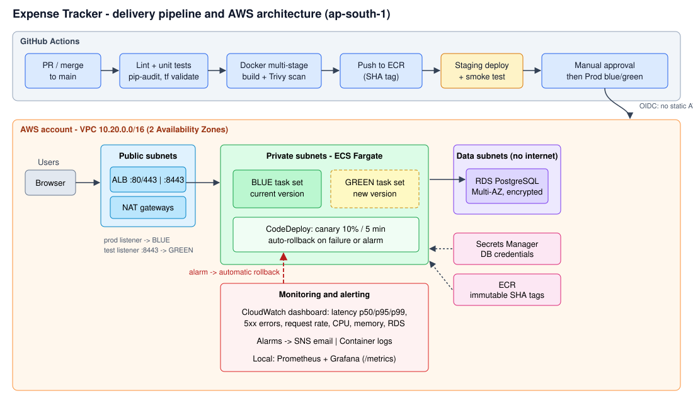
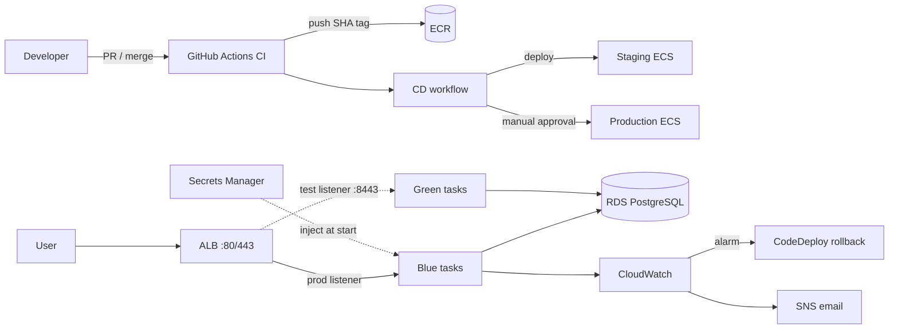

# Architecture

## Flow

1. A developer opens a PR. **CI** runs lint, unit tests, `pip-audit`, `terraform validate`, builds the image and scans it with Trivy.
2. Merge to `main` pushes the image to **ECR** tagged with the commit SHA (tags are immutable).
3. **CD** deploys that exact image to **staging** (all-at-once blue/green), runs a smoke test, then waits for a **manual approval** (GitHub `production` environment reviewers).
4. Production uses a **CodeDeploy blue/green canary**: green tasks start behind the ALB test listener (:8443), 10% of traffic shifts, a 5-minute bake follows, then the remaining 90% shifts. Blue is kept for 1 minute, then terminated.
5. If green never becomes healthy, or a CloudWatch alarm (5xx, p95 latency, unhealthy hosts) fires during the shift, **CodeDeploy rolls traffic back to blue automatically** and the CD job fails.

## Components

| Layer | Service | Notes |
|---|---|---|
| Registry | ECR | immutable SHA tags, scan on push, keep last 30 |
| Network | VPC, 2 AZs | public (ALB, NAT), private (Fargate tasks), data (RDS, no internet route) |
| Compute | ECS Fargate, `CODE_DEPLOY` controller | 2 tasks in prod, CPU-based autoscaling (x3 max) |
| Traffic | ALB, blue + green target groups | health check `/readyz` (also checks DB) |
| Database | RDS PostgreSQL 16 | encrypted, private, Multi-AZ in prod, 7-day backups in prod |
| Secrets | Secrets Manager | DB credentials generated by Terraform, injected by ECS at task start |
| CI/CD auth | GitHub OIDC -> IAM roles | no static AWS keys; prod role only assumable from the `production` environment |
| Observability | CloudWatch dashboard + alarms + SNS; Prometheus/Grafana locally | latency, errors, CPU/memory, RDS |
| State | S3 + DynamoDB lock | remote Terraform state per environment |

## Why zero downtime

- The old (blue) task set serves 100% of traffic until green is healthy.
- Traffic is moved at the ALB listener, not by replacing running containers.
- DB schema changes must be backward compatible (expand, then contract), because blue and green share one database for a few minutes.

## Mermaid version (renders on GitHub)

